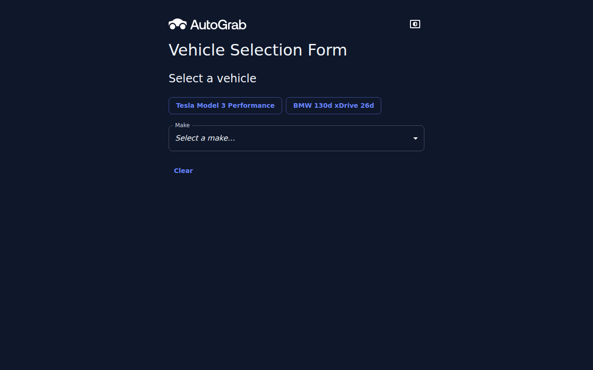
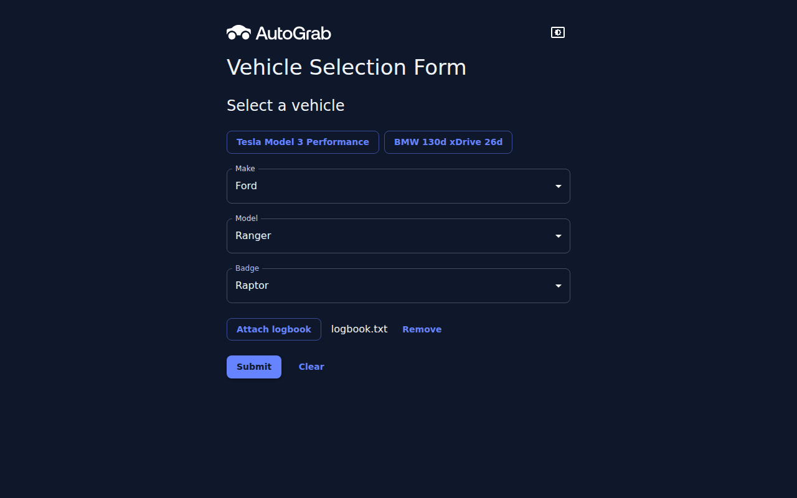
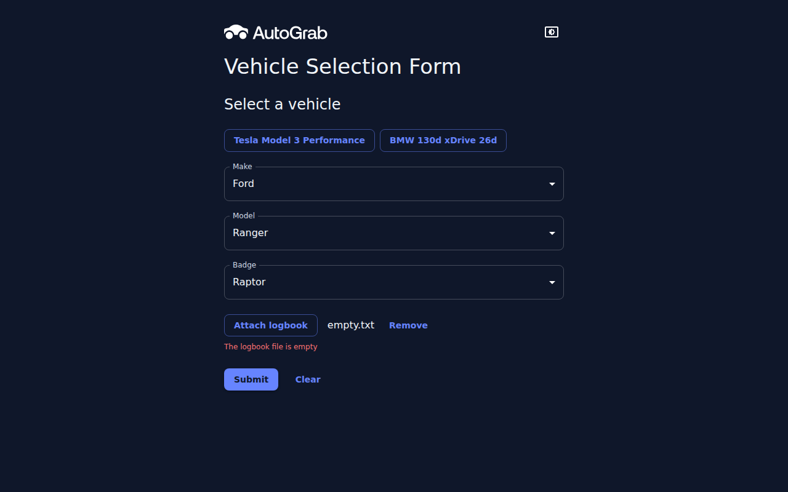
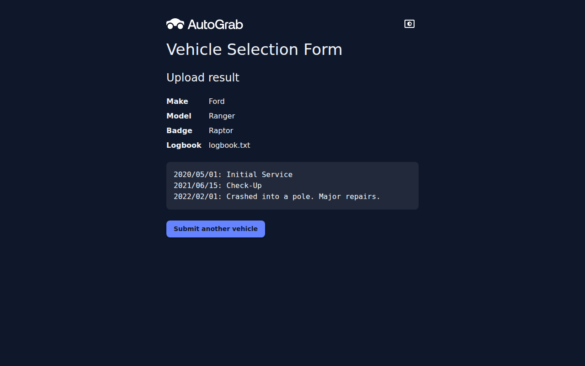
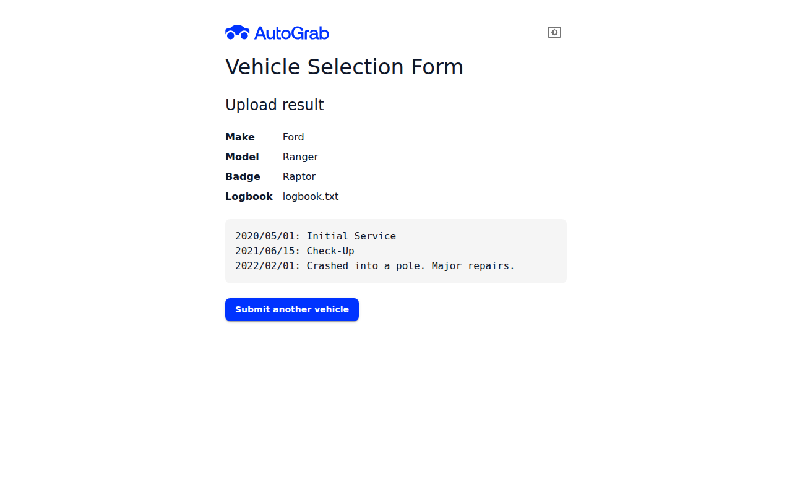
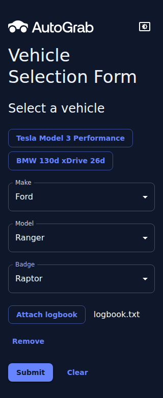

# AutoGrab Vehicle Selection Form

A React + TypeScript form for selecting a vehicle (Make → Model → Badge) and optionally attaching its service logbook as a plain-text file. The form is submitted to a Node.js/Express server, which validates it and returns the vehicle details and logbook contents for display.

## Requirements

- Node.js 24 (see `.nvmrc`; run `nvm use` if you use nvm)
- npm 10 or later

## Quick start

```bash
npm install
npm run dev
```

Then open http://localhost:5173.

`npm run dev` starts both apps:

| App    | URL                   | Notes                                         |
| ------ | --------------------- | --------------------------------------------- |
| Client | http://localhost:5173 | Vite dev server; proxies `/api` to the server |
| Server | http://localhost:3001 | Express API; port configurable via `PORT`     |

A sample logbook is provided at [samples/logbook.txt](samples/logbook.txt).

## Scripts

Run from the repository root:

| Command          | Description                           |
| ---------------- | ------------------------------------- |
| `npm run dev`    | Start client and server in watch mode |
| `npm run build`  | Type-check and build all workspaces   |
| `npm run lint`   | Lint all workspaces                   |
| `npm run format` | Format the repo with Prettier         |
| `npm test`       | Run client, server and shared tests   |

## Using the form

1. Choose a **Make**. The **Model** field appears.
2. Choose a **Model**. The **Badge** field appears.
3. Choose a **Badge**. The logbook upload and **Submit** button appear.
4. Optionally attach a plain-text logbook (max 1 MB).
5. Click **Submit**. The app moves to the `/upload` page, which shows the submitted vehicle and logbook contents. **Submit another vehicle** returns to an empty form.

Changing a Make or Model clears the fields below it. The **quick-select** buttons (Tesla Model 3 Performance, BMW 130d xDrive 26d) fill in all three fields at once, and **Clear** resets the form.

| Page      | Shows                                              |
| --------- | -------------------------------------------------- |
| `/`       | The vehicle selection form                         |
| `/upload` | The submitted selections and logbook contents only |

## Screenshots

| The empty form, with the quick-select buttons  | A selected vehicle with a logbook attached       |
| ---------------------------------------------- | ------------------------------------------------ |
|  |  |

| An empty logbook, rejected straight away          | The result page                             |
| ------------------------------------------------- | ------------------------------------------- |
|  |  |

| The result page in light mode                                 | The form on a 320px-wide screen                     |
| ------------------------------------------------------------- | --------------------------------------------------- |
|  |  |

Use the icon in the header to switch between the System, Light and Dark themes.

## Project structure

```
client/   React + TypeScript + Vite + Material UI + React Router + React Hook Form front end
server/   Express + TypeScript API
shared/   Vehicle data (vehicles.json), Zod schemas, types and helpers used by both
samples/  Sample logbook file
```

The vehicle data lives once, in `shared/`, and is imported by both the client (to build the dropdowns) and the server (to validate submissions). Everything in `shared/` is exported from `shared/src/index.ts`, so both import from the one path, `@autograb/shared`.

## Project documents

| Document                                                             | Contents                                                    |
| -------------------------------------------------------------------- | ----------------------------------------------------------- |
| [AutoGrab-VehicleSelectionForm.md](AutoGrab-VehicleSelectionForm.md) | The original challenge brief                                |
| [tech-stack.md](tech-stack.md)                                       | Libraries used and why, plus what was deliberately left out |
| [future-improvements.md](future-improvements.md)                     | What would come next, and why it was left out               |

## API

The server is a JSON API, and all its routes are under `/api`. Page routes such as `/upload` belong to the client.

### `POST /api/upload`

`multipart/form-data` fields:

| Field     | Type   | Required |
| --------- | ------ | -------- |
| `make`    | string | yes      |
| `model`   | string | yes      |
| `badge`   | string | yes      |
| `logbook` | file   | no       |

**200 OK**

```json
{
  "make": "tesla",
  "model": "Model 3",
  "badge": "Performance",
  "logbook": {
    "filename": "logbook.txt",
    "contents": "2020/05/01: Initial Service\n..."
  }
}
```

`logbook` is `null` when no file is attached.

**Errors**

```json
{
  "error": {
    "message": "Badge 'XR8' is not available for Ford Falcon Ute",
    "field": "badge"
  }
}
```

| Status | Meaning                                                    |
| ------ | ---------------------------------------------------------- |
| 400    | Missing or invalid selection, or empty logbook             |
| 413    | Logbook larger than 1 MB                                   |
| 415    | Logbook is not plain text (must be valid UTF-8, no binary) |
| 500    | Unexpected server error                                    |

Try it with curl while the server is running:

```bash
curl -F make=tesla -F model="Model 3" -F badge=Performance \
     -F logbook=@samples/logbook.txt http://localhost:3001/api/upload
```

## Design notes

- **Plain-text detection is based on content, not file extension.** Files are accepted if they decode as UTF-8 and contain no NUL bytes, so `.log`, `.md` or extension-less text files work. A leading BOM is stripped and Windows line endings are normalised.
- **Uploads are never written to disk.** Multer keeps the file in memory, with a 1 MB limit.
- **One validation schema, used twice.** The Make/Model/Badge rules are a Zod schema in `shared/`. The form validates with it through React Hook Form, and the server validates with the same schema, so both give identical messages. API request and response types are inferred from the schemas.
- **The server validates selections against the shared vehicle data.** It doesn't trust the client's dropdowns. Badge names repeat across models (e.g. `XR6`), so validation always checks the full Make → Model → Badge path.
- **No database, auth or state-management library.** These were left out deliberately; see [tech-stack.md](tech-stack.md#deliberately-not-used) for the reasons.

## Future improvements

Work the brief doesn't ask for, such as a database for vehicle data and submissions, authentication, production deployment and an accessibility pass, is listed in [future-improvements.md](future-improvements.md).

## License

The code in this repository is released under the [MIT License](LICENSE).

The challenge brief ([AutoGrab-VehicleSelectionForm.md](AutoGrab-VehicleSelectionForm.md)) and the supplied vehicle data belong to AutoGrab. They are included for reference only and are not covered by the MIT License.

The AutoGrab name, logos and favicon (in [client/public/](client/public/)) and the brand they represent belong to AutoGrab and are not covered by the MIT License. They are used only to theme this coding challenge, which is not an official AutoGrab product.
